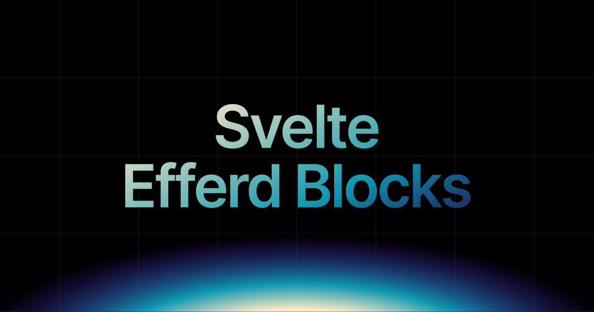

## Svelte Efferd Blocks

Browse beautiful shadcn-svelte marketing blocks for landing pages, hero sections, CTAs, pricing, testimonials, FAQs, headers, footers, and more.

Total Blocks: 82

Live Preview: [sv-efferd.pages.dev](https://sv-efferd.pages.dev)

## Features

- 82 free and open-source blocks across 19 categories
- Responsive layouts for mobile and desktop
- Light and dark mode support
- Built with Svelte 5, Tailwind CSS, and shadcn-svelte
- Live previews with responsive controls
- One-command installs with the shadcn-svelte CLI
- Fully editable source code
- Component metadata for AI tools

## AI and agent resources

- [`llms.txt`](https://sv-efferd.pages.dev/llms.txt): A short project guide for AI tools
- [`component-manifest.json`](https://sv-efferd.pages.dev/component-manifest.json): Categories, tags, previews, and install commands
- [`registry index`](https://sv-efferd.pages.dev/r/index.json): All installable registry items

## New Categories

- [Dashboard](https://sv-efferd.pages.dev/blocks/dashboard)
- [App Shell](https://sv-efferd.pages.dev/blocks/app-shell)
- [Settings](https://sv-efferd.pages.dev/blocks/settings)
- [Team](https://sv-efferd.pages.dev/blocks/team)

## Categories :

- [Logo Cloud](https://sv-efferd.pages.dev/blocks/logo-cloud)
- [Header](https://sv-efferd.pages.dev/blocks/header)
- [Not Found](https://sv-efferd.pages.dev/blocks/not-found)
- [Testimonials](https://sv-efferd.pages.dev/blocks/testimonials)
- [Contact](https://sv-efferd.pages.dev/blocks/contact)
- [Blog](https://sv-efferd.pages.dev/blocks/blog)
- [CTA](https://sv-efferd.pages.dev/blocks/cta)
- [FAQ's](https://sv-efferd.pages.dev/blocks/faqs)
- [Features](https://sv-efferd.pages.dev/blocks/features)
- [Footer](https://sv-efferd.pages.dev/blocks/footer)
- [Integrations](https://sv-efferd.pages.dev/blocks/integrations)
- [Hero](https://sv-efferd.pages.dev/blocks/hero)
- [Auth](https://sv-efferd.pages.dev/blocks/auth)
- [Pricing](https://sv-efferd.pages.dev/blocks/pricing)
- [Image Gallery](https://sv-efferd.pages.dev/blocks/image-gallery)

## Install

Install any block using `shadcn-svelte` CLI:

```bash
pnpm dlx shadcn-svelte@latest add https://sv-efferd.pages.dev/r/<component-name>.json
```

Example:

```bash
pnpm dlx shadcn-svelte@latest add https://sv-efferd.pages.dev/r/hero-one.json
```

## Usage

```svelte
<script lang="ts">
  import HeroOne from "#lib/components/efferd/hero/hero-one.svelte";
</script>

<HeroOne />
```

## Other projects

More Svelte projects by [Bhide Svelte](https://bhide.dev):

- [Svelte Animations](https://sv-animations.vercel.app/) - Svelte port of Magic UI, Spell UI, Fancy Components, and more. [GitHub](https://github.com/SikandarJODD/animations)
- [Svelte Marketing Blocks](https://sv-blocks.vercel.app/) - 150+ reusable marketing sections and landing-page blocks. [GitHub](https://github.com/SikandarJODD/cnblocks)
- [Svelte Premium Marketing Blocks](https://sv-efferd.pages.dev/) - 60+ polished marketing blocks for high-quality Svelte sites. [GitHub](https://github.com/SikandarJODD/sv-efferd)
- [Svelte AI Elements](https://svelte-ai-elements.vercel.app/) - Composable Svelte elements for AI product interfaces. [GitHub](https://github.com/SikandarJODD/ai-elements)
- [Svelte Particles](https://sv-particles.vercel.app/) - Interactive particle effects and examples for Svelte. [GitHub](https://github.com/SikandarJODD/sv-particles)
- [Svelte Data Table Components](https://sv-table.vercel.app/) - 20+ data table components, patterns, and practical examples. [GitHub](https://github.com/SikandarJODD/sv-table)
- [Svelte Globe Examples](https://sv-globe.vercel.app/) - Interactive globe examples and visual experiments. [GitHub](https://github.com/SikandarJODD/sv-globe)
- [Svelte Dot Matrix Loaders](https://sv-matrix.vercel.app/) - 50+ free, open-source dot-matrix loaders. [GitHub](https://github.com/SikandarJODD/sv-matrix)

## Libraries

- [Svelte Agentation](https://sv-agentation.com/) (`sv-agentation`) - Add notes to a page and send them to AI coding agents. [GitHub](https://github.com/SikandarJODD/sv-agentation)
- Svelte Drawesome (`sv-drawesome`) - Add a drawing toolbar to a Svelte 5 app. [GitHub](https://github.com/SikandarJODD/sv-drawesome)
- [Svelte Pierre Words](https://sv-pierre.pages.dev/) (`@sv-pierre/words`) - Render static or streaming Markdown in Svelte. [GitHub](https://github.com/SikandarJODD/sv-pierre)

## Credits

- Original created by [Shaban](https://x.com/shabanhr)
- Ported to Svelte by [Bhide Svelte](https://x.com/Sikandar_Bhide)

## Support

If you find Svelte Efferd Blocks useful:

- Star the repo
- Share your work on social media and tag [@Sikandar_Bhide](https://x.com/Sikandar_Bhide)
- Sponsor the project usng GitHub Sponsors

[](https://github.com/sponsors/SikandarJODD)

Made with love for the Svelte community by [Bhide Svelte](https://x.com/Sikandar_Bhide).
